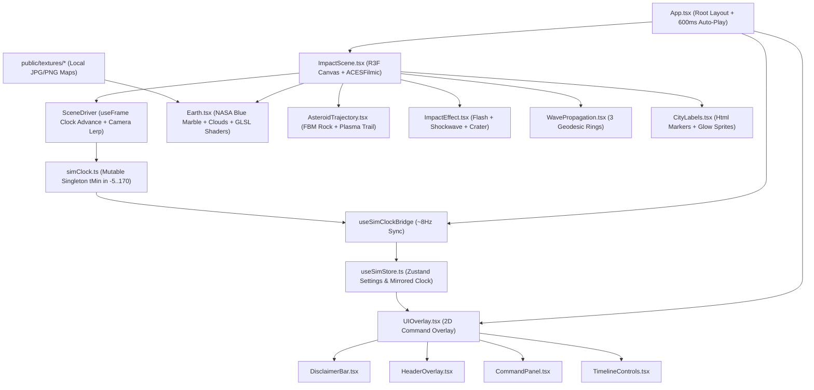

# Caribbean Asteroid Twin

**A fictional cinematic 3D digital twin for communicating time-based geospatial narratives through an interactive command-center interface.**

[Open live demo](https://caribbean-asteroid-twin.vercel.app) · [Jovan Franco](https://www.jovanfranco.com)

> **FICTIONAL SIMULATION — NOT A FORECAST OR EMERGENCY TOOL.**
>
> This project is a stylized portfolio and educational visualization. It must never be used for navigation, emergency planning, evacuation decisions, scientific prediction, or public-safety communication. There is no real asteroid or real impact. Wave propagation, arrival times, energy, crater size, and affected zones are illustrative constants—not physical or scientific outputs.

---

## 1. Product Purpose & Problem Solved

**Product:** Caribbean Asteroid Twin (`caribbean-asteroid-twin`) is a static, client-side React + Three.js interactive demonstrator depicting a hypothetical asteroid impact near Puerto Rico (`PR-ASTEROID-01`) and stylized geodesic wavefronts expanding across the Caribbean toward South Florida.

**Problem Solved:** Traditional geospatial maps struggle to convey multi-phase temporal events intuitively, while complex scientific simulations are inaccessible to executive or public audiences. This demonstrator shows how a real-time 3D command-center interface can communicate complex spatial timelines cleanly—while enforcing explicit confidence limits, fictional labeling, and responsible-use guardrails so visual storytelling is never mistaken for operational intelligence.

### Portfolio Classification

| Dimension | Verified State |
| --- | --- |
| **Product type** | Interactive cinematic digital-twin showcase (non-production) |
| **AEAS portfolio category** | Showcases, Sandboxes, Labs, Websites & Demos (non-production) |
| **Data source** | Embedded fictional constants in [`src/data/ScenarioData.ts`](src/data/ScenarioData.ts) |
| **Scientific validity** | None claimed (no bathymetry, shallow-water solver, or physics engine) |
| **Backend / APIs / DB** | None (100% static browser bundle) |
| **Personal or customer data** | None collected or stored |
| **Deployment target** | Static Vite SPA on Vercel ([`vercel.json`](vercel.json)) |

---

## 2. Implemented Capabilities (Verified in Source)

Every capability below is verified directly against the current `main` codebase:

- **PBR 3D Earth & Atmosphere ([`src/components/scene/Earth.tsx`](src/components/scene/Earth.tsx)):** Renders a 128×128 sphere mapped with locally bundled NASA Blue Marble textures (`public/textures/earth_day.jpg`, `earth_normal.jpg`, `earth_specular.jpg`, `earth_clouds.png`), an independently rotating cloud layer, and two custom GLSL Fresnel shaders (outer Rayleigh-style rim glow and inner limb haze), plus a `satelliteView` emissive toggle.
- **Procedural Starfield & Asteroid Approach (`Stars.tsx`, `AsteroidTrajectory.tsx`):** Generates a 2,500-star (or 1,200-star in low quality) spherical point cloud and an FBM noise-displaced icosahedron asteroid traveling along a quadratic Bézier path from `ASTEROID_ORIGIN` (`52.0°W, 38.0°N`) to `IMPACT_SITE` (`66.6°W, 18.6°N`) during `T-05m` to `T+00m`, accompanied by a plasma glow sprite and tapered cylinder trail.
- **Impact Flash & Geodesic Wave Propagation (`ImpactEffect.tsx`, `WavePropagation.tsx`, [`src/lib/geo.ts`](src/lib/geo.ts)):** Renders an impact flash sprite, mutable geodesic shockwave line, ejecta disk, pulsing crater ring, and three concentric geodesic wavefront rings (`#ff5a3c` up to 900 km / 60m, `#ffb84d` up to 1,700 km / 120m, `#36c5ff` up to 2,600 km / 170m) computed via spherical destination-point math (`geodesicRing`).
- **Decoupled Simulation Clock ([`src/lib/simClock.ts`](src/lib/simClock.ts), [`src/hooks/useSim.ts`](src/hooks/useSim.ts)):** Advances mutable simulation time `tMin` inside React Three Fiber's `useFrame` loop (`1×`, `5×`, `20×` simulated minutes per real second, clamped to `[-5, 170]`) and emits throttled snapshots at ~8 Hz (`1/8` s) to Zustand (`useSimStore`), avoiding 60 fps React tree re-renders. Auto-starts playback 600 ms after mount (`src/App.tsx`).
- **Bilingual Command-Center Overlay (`UIOverlay.tsx`, `src/i18n/dict.ts`):** Full English (`en`) / Spanish (`es`) toggle covering the persistent `DisclaimerBar`, `HeaderOverlay` (phase badge + wave legend), `CommandPanel` (scenario telemetry + 6 city arrival indicators), and `TimelineControls` (scrubbable `T-05m` to `T+170m` track, play/pause/reset, speed selectors, 4 camera presets: `puertoRico`, `caribbeanWide`, `miami`, `space`, and 6 layer toggles: `wavefronts`, `labels`, `impactRadius`, `timeline`, `satelliteView`, `asteroid`).
- **Adaptive Quality & Responsive Layout (`ImpactScene.tsx`, [`src/state/useSimStore.ts`](src/state/useSimStore.ts), `src/styles/App.css`):** Initializes `quality` to `'low'` when `max-width: 768px` matches (disabling `EffectComposer`/`Bloom` postprocessing, lowering DPR ceiling to `1.3`, reducing star count to `1200`, and reducing ring segments to `72`). CSS breakpoints narrow the left `CommandPanel` below `720px` and hide it below `560px` to preserve 3D viewport visibility on phones.

### Capabilities Not Implemented / Out of Scope

- **Automated Test Suite (`NOT_STARTED`):** No unit, integration, or end-to-end test runner or test files exist in the repository.
- **CI/CD Workflows (`NOT_STARTED`):** No `.github/workflows/` pipeline files exist in the repository.
- **Open-Source License (`NOT_STARTED`):** No `LICENSE` file is included.
- **Real Hazard / Physics Modeling (Out of Scope by Design):** No shallow-water equations, bathymetry, DEM topography, live telemetry feeds, or predictive modeling.

---

## 3. Fictional Scenario Parameters

Defined in [`src/data/ScenarioData.ts`](src/data/ScenarioData.ts) (`SCENARIO`, `IMPACT_SITE`, `PHASES`, `CITIES`):

| Parameter | Value in Code |
| --- | --- |
| **Scenario ID** | `PR-ASTEROID-01` |
| **Impact site** | `18.6°N, 66.6°W` (Mona Passage / northern Puerto Rico area — fictional) |
| **Simulation window** | `T-05m` (`SIM_START_MIN = -5`) to `T+170m` (`SIM_END_MIN = 170`) |
| **Impact energy** | `~1.2 × 10³` megatons TNT equiv. (stylized) |
| **Transient crater** | `≈ 18 km` (stylized) |
| **Propagation speed** | `≈ 620 km/h` (visual pacing) |
| **Peak wave amplitude** | `≈ 12 m` (visual scale) |

### Timeline Phase Markers (`PHASES`)

| Timestamp (`tMin`) | Phase (EN) | Phase (ES) |
| --- | --- | --- |
| `T-03m` | Asteroid approach | Aproximación del asteroide |
| `T+00m` | Impact | Impacto |
| `T+05m` | Initial wave ring | Anillo de onda inicial |
| `T+30m` | Caribbean propagation | Propagación por el Caribe |
| `T+90m` | Bahamas corridor | Corredor de las Bahamas |
| `T+150m` | South Florida / Miami visual arrival | Arribo visual al sur de Florida / Miami |

*Note: Playback starts at `T-05m` (`SIM_START_MIN = -5`), where the approach trajectory begins animating toward impact at `T+00m`; the first timeline marker pill sits at `T-03m`. City arrival timestamps (`San Juan T+3m`, `Ponce T+6m`, `Santo Domingo T+26m`, `Nassau T+88m`, `Havana T+92m`, `Miami T+150m`) are authored constants, not computed from fluid dynamics.*

---

## 4. Architecture & Technology Stack



### Repository Structure

```text
public/
└── textures/          Bundled NASA Blue Marble day, normal, specular, and cloud maps
src/
├── components/
│   ├── scene/         Earth, Stars, AsteroidTrajectory, ImpactEffect, WavePropagation, CityLabels, ImpactScene
│   └── ui/            DisclaimerBar, HeaderOverlay, CommandPanel, TimelineControls, UIOverlay
├── data/              ScenarioData.ts (fictional scenario, cities, phases, wave rings)
├── hooks/             useSim.ts (useSimClockBridge, useT, store selectors)
├── i18n/              dict.ts (English and Spanish UI dictionaries)
├── lib/               geo.ts (spherical math & geodesic rings) and simClock.ts
├── state/             useSimStore.ts (Zustand UI, camera, layer, and quality state)
├── styles/            tokens.css and App.css (responsive breakpoints at 720px & 560px)
├── three/             earthTexture.ts (radial canvas glow-sprite generator for markers/flashes)
├── App.tsx            Root component
└── main.tsx           React 18 entry point
```

### Verified Dependencies ([`package.json`](package.json))

| Layer | Packages |
| --- | --- |
| **UI & State** | `react` (`^18.3.1`), `react-dom` (`^18.3.1`), `zustand` (`^4.5.5`) |
| **3D & Postprocessing** | `three` (`^0.169.0`), `@react-three/fiber` (`^8.17.10`), `@react-three/drei` (`^9.114.0`), `@react-three/postprocessing` (`^2.16.3`) |
| **Build & Tooling** | `vite` (`^5.4.9`), `@vitejs/plugin-react` (`^4.3.2`), `typescript` (`^5.6.3`), `@types/*` |

---

## 5. Integrations, Environment Variables & Data Model

- **External Integrations:** None at runtime. All textures reside in `public/textures/` and all scenario constants reside in `src/data/ScenarioData.ts`.
- **Environment Variables:** None required and none referenced in source code (no `.env.example` exists).
- **Data Model & Migrations:** No database or SQL migrations. All state is ephemeral client-side state split between `SimClock` (imperative `tMin`, `playing`, `speed` in `src/lib/simClock.ts`) and `useSimStore` (Zustand store in [`src/state/useSimStore.ts`](src/state/useSimStore.ts)).

---

## 6. Installation, Local Execution & Deployment

### Prerequisites

- Node.js and `npm` compatible with Vite 5 and TypeScript 5.6.

### Verified Scripts ([`package.json`](package.json))

```bash
# Install dependencies
npm install

# Start Vite development server (http://localhost:5173, host: true)
npm run dev

# Run TypeScript strict type-checking (tsc -b --noEmit)
npm run typecheck

# Build production bundle (tsc -b && vite build -> dist/)
npm run build

# Preview production build locally
npm run preview
```

### Deployment ([`vercel.json`](vercel.json))

Configured as a Vite single-page application on Vercel:

- `framework`: `"vite"`
- `installCommand`: `"npm install"`
- `buildCommand`: `"npm run build"`
- `outputDirectory`: `"dist"`
- `rewrites`: `/(.*) -> /`

---

## 7. Testing, Quality & Security

### Testing & Verification Evidence

| Check / Artifact | Status in `HEAD` | Notes |
| --- | --- | --- |
| **TypeScript strict config** | Present (`tsconfig.app.json`) | `strict: true`, `noUnusedLocals: true`, `noUnusedParameters: true` (`npm run typecheck`) |
| **Production bundle build** | Configured (`package.json`) | `npm run build` (`tsc -b && vite build`); not executed during this docs-only reconciliation pass |
| **Automated test suite** | `NOT_STARTED` | 0 unit, integration, or E2E test files in repository |
| **CI/CD workflows** | `NOT_STARTED` | No `.github/workflows/*` files present |

### Security & Privacy

- Static browser-only application with no authentication, no backend, no user-data persistence, and no secrets.
- Persistent fictional-scenario warning rendered in `DisclaimerBar.tsx` and `HeaderOverlay.tsx`.
- Vulnerability reporting and testing boundaries are documented in [`SECURITY.md`](SECURITY.md).

---

## 8. Roadmap Status & Global Portfolio Reconciliation

Aligned with the Aloria Engineering Assurance Standard portfolio register (`AEAS_PORTFOLIO_ROADMAP_REGISTER_20261120.md`), which classifies `caribbean-asteroid-twin` under **Showcases, Sandboxes, Labs, Websites & Demos** (non-production portfolio demonstrator). Because this is a showcase/demonstrator without automated tests or operational SLAs, it is explicitly **not** marked `PRODUCTION_READY`.

| Capability / Workstream | Status | Scope & Verified Evidence (`2026-11-23`) |
| --- | --- | --- |
| **3D PBR Globe, Shaders & Starfield** | `IMPLEMENTED` | Verified in `Earth.tsx`, `Stars.tsx`, `public/textures/*` |
| **Asteroid Approach & Impact Sequence** | `IMPLEMENTED` | Verified in `AsteroidTrajectory.tsx`, `ImpactEffect.tsx` |
| **Geodesic Wavefront Propagation** | `IMPLEMENTED` | Verified in `WavePropagation.tsx`, `src/lib/geo.ts` |
| **Decoupled SimClock & ~8 Hz Bridge** | `IMPLEMENTED` | Verified in `src/lib/simClock.ts`, `src/hooks/useSim.ts` |
| **Bilingual Command UI & Responsive Tiers** | `IMPLEMENTED` | Verified in `src/components/ui/*`, `src/i18n/dict.ts`, `App.css` |
| **Static Vercel SPA Deployment Config** | `IMPLEMENTED` | Verified in [`vercel.json`](vercel.json) |
| **Automated Tests (Unit / E2E)** | `NOT_STARTED` | 0 test files in `HEAD` |
| **GitHub Actions CI Pipeline** | `NOT_STARTED` | 0 workflow files in `HEAD` |
| **Canonical Governance Alignment** | `PARTIALLY_IMPLEMENTED` | Open draft governance PRs (`#2`, `#3`) exist on GitHub; not merged into `main` |

**Completion Metrics (as of `2026-11-23`):**
- **Interactive Showcase Feature Scope:** `6 / 6 (100%)` core visual demonstrator capabilities `IMPLEMENTED` (formula: `implemented_showcase_capabilities / total_showcase_capabilities`, scope: static 3D portfolio demonstrator in `src/` + `vercel.json`, evidence: source code inspection on `main`).
- **Automated Quality Assurance Scope:** `0 / 2 (0%)` automated QA gates (`automated_test_suite`, `ci_workflow`) implemented (formula: `implemented_qa_gates / 2`, scope: repository CI & testing, evidence: `test_files = []`, `workflow_files = []`).

### Known Limitations & External Dependencies

- **Not physical:** No shallow-water equations, bathymetry, impact physics, or scientific solver.
- **Illustrative timing & geography:** City arrival timestamps are authored constants; markers and rings are visual overlays.
- **Bundle size:** Three.js and `@react-three/postprocessing` produce a sizable client-side WebGL bundle.
- **Governance & CI:** Open draft PRs (`#2`, `#3`) and automated test/CI setup remain external to `main` until reviewed and merged by a maintainer.

---

## 9. Contributing & License

- **Contributing:** See [`CONTRIBUTING.md`](CONTRIBUTING.md). Contributions must preserve the fictional classification, bilingual clarity, and responsible-use boundaries.
- **Security:** See [`SECURITY.md`](SECURITY.md).
- **License:** No open-source license is currently included. Public repository visibility does not grant permission to reuse the source or presentation as an official forecast, emergency system, or scientific model.
